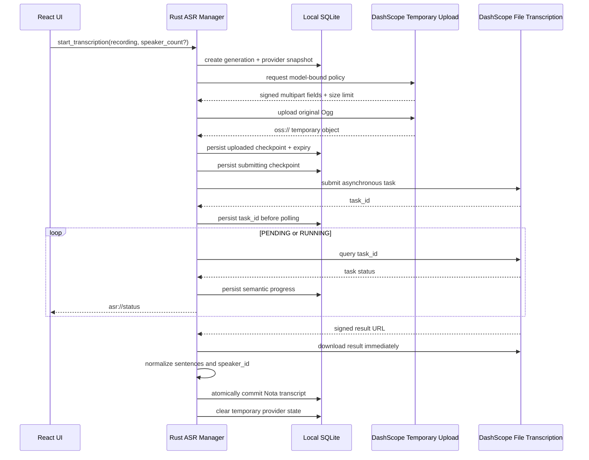
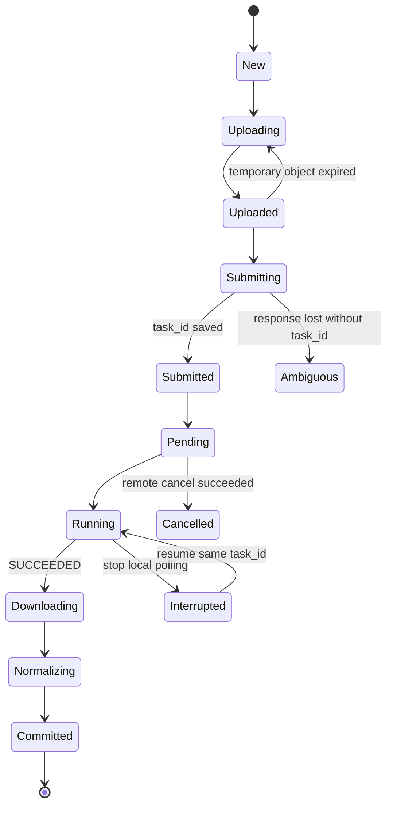
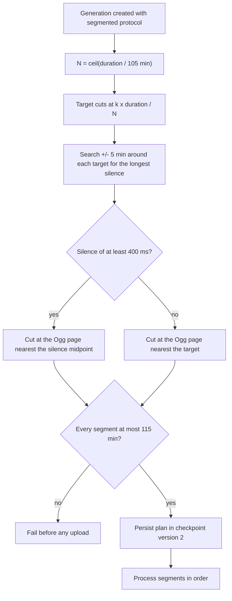
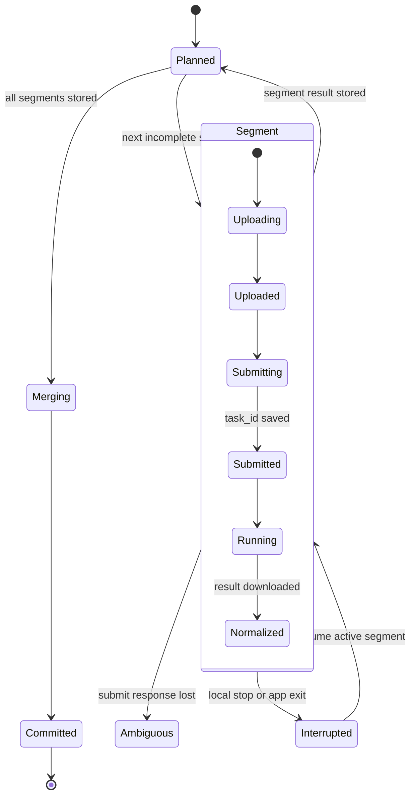

# DashScope File Transcription Provider

- Status: Accepted
- Last updated: 2026-11-27
- Owners: Nota maintainers
- Related code: `src-tauri/src/asr/`, `src-tauri/src/models.rs`,
  `src-tauri/src/storage.rs`, `src/components/SettingsWorkspace.tsx`, and
  `src/components/SpeakerIdentificationModal.tsx`
- Related decision:
  [`0010-direct-dashscope-file-transcription.md`](decisions/0010-direct-dashscope-file-transcription.md),
  [`0013-configurable-trusted-dashscope-api-roots.md`](decisions/0013-configurable-trusted-dashscope-api-roots.md),
  [`0018-segment-long-dashscope-recordings.md`](decisions/0018-segment-long-dashscope-recordings.md)

## Purpose and Boundary

Nota connects directly from its Rust backend to Alibaba Cloud DashScope for
whole-recording transcription. React sends user intent through typed IPC but
never reads the recording, stored API key, temporary object URL, provider task
response, or raw transcript payload. Nota ASR Server remains the self-hosted
inference and voiceprint-extraction service; it is not a DashScope proxy.

The model and transcription contract remain fixed, while the API root is
user-configurable so an installation can use either the compatible shared
DashScope domain or its Alibaba Cloud Model Studio workspace-specific domain:

| Setting | Value |
|---|---|
| API root | Trusted Alibaba Cloud HTTPS root ending in `/api/v1`; defaults to `https://dashscope.aliyuncs.com/api/v1` |
| Model | `qwen-audio-3.0-asr-flash-filetrans` |
| Input | One original Nota Ogg recording |
| Language | Automatic detection |
| Speaker diarization | Always enabled |
| Speaker count | Automatic or a reference value from 2 through 100 |
| Reliable duration | At most two hours per uploaded file while diarization is enabled; longer recordings are segmented |
| Upload | DashScope model-bound temporary object, retained for about 48 hours |

The model returns meeting-local anonymous labels such as `speaker_0`; it does
not participate in Nota voiceprint analysis or cross-meeting identity matching.
Users may still preview representative utterances and assign local names.

## Provider Capabilities

Provider behavior is exposed as typed capabilities instead of being inferred
through repeated provider-kind checks in React. Capabilities cover whole-file
processing, diarization, speaker-count limits, voiceprint analysis, model
discovery, cloud upload, and the reliable duration limit.

Capabilities are snapshotted with each transcription generation. Changing the
current default provider must not change the behavior of an existing transcript:

- a DashScope generation never permits Nota voiceprint analysis;
- a FunASR generation may still use the separately configured voiceprint
  provider after the default transcription provider changes;
- retranscription creates a new generation and snapshots the newly selected
  provider capabilities.

## Runtime Flow

## Durable State and Recovery

`transcriptions.provider_kind` stores the generation provider snapshot.
`transcriptions.provider_state_json` stores a versioned, provider-private
checkpoint. DashScope uses the existing `remote_job_id` for `task_id` and the
checkpoint for the current stage, the temporary object reference and expiry,
and the submit-attempt time.

Recovery rules are conservative about duplicate billing:

- a valid uploaded object may be reused before task submission;
- an expired object is uploaded again;
- a saved `task_id` is queried and is never resubmitted;
- a `submitting` checkpoint without `task_id` is ambiguous and cannot retry
  automatically because DashScope has no Nota idempotency key;
- an expired or `UNKNOWN` task requires an explicit fresh transcription;
- provider URLs are removed after the normalized transcript is durable.

Only a `PENDING` DashScope task can be cancelled remotely. A `RUNNING` task is
interrupted locally, retains its task id, and may continue incurring provider
work. Resuming queries that same task.

## Recordings Longer Than Two Hours

Decision record:
[`0018-segment-long-dashscope-recordings.md`](decisions/0018-segment-long-dashscope-recordings.md).
Code: `src-tauri/src/audio/segments.rs` (planning and lossless splitting) and
`src-tauri/src/asr/dashscope_segmented.rs` (job flow and merge).

### Goal and Non-Goals

A recording longer than the two-hour diarization limit is split locally into
shorter segments. Each segment is uploaded and transcribed as an independent
DashScope task, one after another, and the results are merged into one Nota
transcript.

Speaker labels are **not** aligned across segments. Each segment's labels are
renumbered after the previous segment's labels, so one person may appear as
`speaker_1` in segment 1 and `speaker_5` in segment 2. The user merges them by
giving both labels the same meeting-local name. Names are keyed by raw label
and are not unique, and transcripts and AI documents render the name.

Out of scope: cross-segment speaker alignment, overlapping segments, parallel
task submission, disabling diarization, and Nota voiceprint analysis for
DashScope generations.

### Protocol Selection

When a DashScope generation is created, Nota selects the protocol from the
recorded duration and snapshots it in `transcriptions.protocol`:

| Recorded duration | Protocol | Behavior |
|---|---|---|
| At most 2 hours | `dashscope_filetrans_v1` | Unchanged single-file flow |
| More than 2 hours | `dashscope_filetrans_segmented_v1` | Segmented flow below |

The single-file flow, its checkpoint version 1, and its recovery rules do not
change. A generation never switches protocol after creation.

### Segment Plan

- `N = ceil(duration / 105 min)`, so a 2 h 01 min meeting becomes two segments
  of about 1 h each instead of 2 h plus 1 min. The 105-minute target and the
  5-minute search window keep every segment at or below 115 minutes, under the
  120-minute limit.
- Silence is measured on the decoded 16 kHz mono signal with 20 ms RMS frames,
  reusing the existing Ogg Opus decoder. Cutting inside a pause avoids
  splitting a sentence between two tasks.
- The plan stores each segment's index and its start and end in milliseconds on
  the original recording timeline. It is persisted before the first upload and
  is never recomputed on resume.

### Lossless Segment Files

Segments are cut from the original Ogg Opus file at page boundaries without
re-encoding. FFmpeg and new runtime dependencies are not needed.

- Each segment file gets a new stream serial, an `OpusHead`, and an
  `OpusTags` packet, followed by the original audio pages for its range.
  Granule positions are rebased to the segment start.
- A segment that does not start at the beginning of the recording also
  includes at least 80 ms of preceding packets as decoder pre-roll. The
  segment's `OpusHead` pre-skip discards that pre-roll, so the segment's first
  audible sample is its planned start.
- Files are created with `create_new` under
  `Recovery\TranscriptionTemp\<recording>-g<generation>-s<index>.ogg`
  immediately before upload and deleted as soon as the upload-and-submit step
  returns, whatever its outcome. The existing temporary-audio cleanup, which
  runs at startup, before a new generation, and on recording deletion, also
  removes leftover segment files. A missing file is regenerated from the
  persisted plan. Segment files hold private audio and leave the recovery
  directory only through the DashScope upload.

### Sequential Processing and Recovery

Segments are processed strictly in order. Each segment runs the same sub-state
machine as the single-file flow: upload, submitting, submitted with a saved
`task_id`, pending, running, downloading, and normalizing.

- Checkpoint version 2 stores the plan, the active segment index, and the
  active segment's version-1 checkpoint: stage, temporary object reference and
  expiry, and submit-attempt time. The active segment's `task_id` is stored in
  `remote_job_id` before polling, exactly as in the single-file flow.
- A completed segment's normalized result is written to
  `transcription_chunks` (`chunk_index` = segment index, `start_ms`/`end_ms` =
  planned range) before the checkpoint moves to the next segment. On resume, a
  segment with a stored row is skipped even if the checkpoint still points at
  it, so a completed segment is never uploaded or submitted again.
- The v1 duplicate-billing rules apply per segment: a saved `task_id` is only
  queried, an expired temporary object is uploaded again, and an ambiguous
  submission fails the generation without retrying. The error names the
  affected segment. Starting a new generation transcribes every segment again
  and may bill the completed segments a second time; the UI says so.
- Cancellation follows the v1 rules for the active segment. Segments after it
  are never submitted.
- Starting a new generation deletes earlier segment rows for that recording,
  as it already does for legacy chunks.

### Merge

When the last segment is stored, Nota merges all rows in one transaction and
commits the transcript through the existing completion path:

1. Add each segment's planned start to its sentence timestamps.
2. Collect the distinct provider speaker labels of each segment, ordered by
   numeric id, and relabel them `speaker_{base + i}`. `base` starts at 0 and
   grows by each segment's distinct label count. Unlabeled sentences stay
   unlabeled.
3. Concatenate segment texts in order with a line break. Cuts fall in
   silence and segments do not overlap, so no text deduplication is needed.
4. Use the first segment language that is present.

A sentence whose timestamps fall outside its segment's planned length, beyond
a small tolerance, fails normalization instead of being silently moved.

### Speaker Count, Hotwords, and Progress

- A user-specified reference speaker count is sent unchanged with every
  segment. A segment may contain fewer speakers than the reference value.
- The generation's hotword snapshot is validated once and sent with every
  segment.
- `transcriptions.segment_index` and `transcriptions.segment_count` back the
  nullable `segmentIndex` and `segmentCount` fields of `TranscriptionSummary`,
  synchronized between Rust and TypeScript. Progress reads, for example,
  "第 2/3 段 · 已上传 4.0 MB / 8.0 MB". Completion clears `segment_index` and
  keeps `segment_count`. Existing phases and units are unchanged.

### Product Interaction

- For a DashScope recording longer than two hours, the transcription options
  dialog states the segment count and that speaker labels are independent per
  segment and must be merged by giving them the same name. The React segment
  count, `ceil(duration / 105 min)`, mirrors the Rust planner.
- Automatic transcription after recording uses the same flow. Its cloud
  disclosure is unchanged.
- Speaker management for a segmented generation adds the same explanation to
  its DashScope banner.

### Diagnostics

Technical logs may add segment index and segment count. The existing privacy
rules are unchanged: no API keys, audio, transcript text, temporary object
URLs, result URLs, or provider bodies.

### Acceptance

Automated tests, with mock HTTP only:

- segment planning for durations just over 2 hours, long recordings, silence
  found and not found, and the 115-minute bound;
- page-aligned splitting that decodes to the planned ranges, with correct
  pre-roll and rebased granules;
- resume after each sub-stage of a middle segment, without re-uploading or
  resubmitting completed segments;
- an ambiguous submission on a later segment, cancellation of a pending and a
  running segment, and expired temporary objects;
- merge offsets, speaker renumbering across segments, unlabeled sentences, and
  out-of-range timestamps;
- unchanged behavior and checkpoint handling for recordings of at most 2 hours.

Manual acceptance uses a real recording of more than 2 hours and confirms the
segment count, continuous timestamps, renumbered speakers, merging by name,
resume without duplicate submission, and privacy-safe logs.

## Result Normalization

The adapter accepts only the documented file-transcription result shape. It
maps every sentence to one `TranscriptSegment`:

- `begin_time` to `startMs`;
- `end_time` to `endMs`;
- `text` without semantic rewriting;
- numeric `speaker_id` to `speaker_N`.

Segments are ordered by timestamps, invalid ranges are rejected, and full text
uses the provider transcript text with sentence text as a validated fallback.
Provider word timestamps are parsed only as bounded input validation in the
first release and are not added to the public Nota transcript schema.

## Product Interaction

DashScope settings expose a local display name, editable API root, and API key.
The model remains visible but read-only. The API root accepts the compatible
shared DashScope domains and workspace-specific `*.maas.aliyuncs.com` domains,
requires HTTPS, and normalizes a bare host or `/api` suffix to `/api/v1`.
Connection testing uses the unsaved draft root to obtain an upload policy
without uploading audio or creating a billed transcription task.

The settings and transcription-options surfaces explain that a complete
recording is uploaded to Alibaba Cloud. Automatic transcription repeats that
the upload begins after recording finalization. Recordings longer than two
hours are split into segments as described in
[Recordings Longer Than Two Hours](#recordings-longer-than-two-hours), because
speaker diarization is always enabled.

Speaker management remains available for DashScope transcripts, but its banner
states that Nota voiceprint analysis is unsupported for that generation.
Representative playback and manual names remain enabled. Voiceprint analysis
and enrollment controls remain unavailable even when a separate FunASR
voiceprint provider is configured.

## Security and Diagnostics

- The API key remains in the existing local SQLite provider record and is
  exposed to React only as `hasApiKey`.
- The configured API root, upload hosts, and result URLs must use HTTPS Alibaba
  Cloud hosts. The configured root must be a DashScope shared domain or a
  Model Studio workspace-specific domain and must end in `/api/v1`.
- Technical logs may contain provider kind, model, phase, HTTP status, bounded
  error codes, recording id, and generation.
- Logs must not contain API keys, authorization headers, audio, transcript
  text, temporary object URLs, signed result URLs, request bodies, or provider
  response bodies.
- The temporary upload cannot be deleted early; cancellation relies on its
  provider-managed expiry.

## Acceptance

Automated tests use mock HTTP services and cover configured shared and
workspace-specific API roots, request URL construction, request headers and
multipart shape, URL validation, limits, normalization, recovery, ambiguous
submission, remote cancellation, local interruption, migrations, UI capability
messaging, and regressions for existing providers. Automated tests never call
DashScope.

Manual acceptance uses the ignored `examples/dashscope-filetrans/sample.ogg`
and confirms upload, asynchronous polling, sentence timestamps, anonymous
speakers, local commit, resume without duplicate submission, and privacy-safe
logs.

## Checklist for Another Third-Party ASR Provider

1. Add a distinct provider kind and protocol; do not overload OpenAI
   compatibility when the lifecycle or result semantics differ.
2. Define capabilities and snapshot the provider kind with each generation.
3. Keep raw audio, credentials, HTTP, normalization, and provider checkpoints
   in Rust; React receives typed capabilities, states, and normalized results.
4. Specify upload ownership, retention, maximum input, timeouts, host
   validation, cancellation, result expiry, and whether submission is
   idempotent.
5. Persist the remote identity before polling and define every crash boundary,
   including an ambiguous submit response.
6. Normalize timestamps, text, language, and anonymous speaker labels into
   Nota-owned types without leaking provider payloads into technical logs.
7. Drive configuration, speaker-count controls, cloud disclosure, and feature
   degradation from capabilities and the generation snapshot.
8. Add mock protocol tests, migration tests, UI tests, manual acceptance, an
   ADR for the durable boundary, and updates to the owning specifications.
