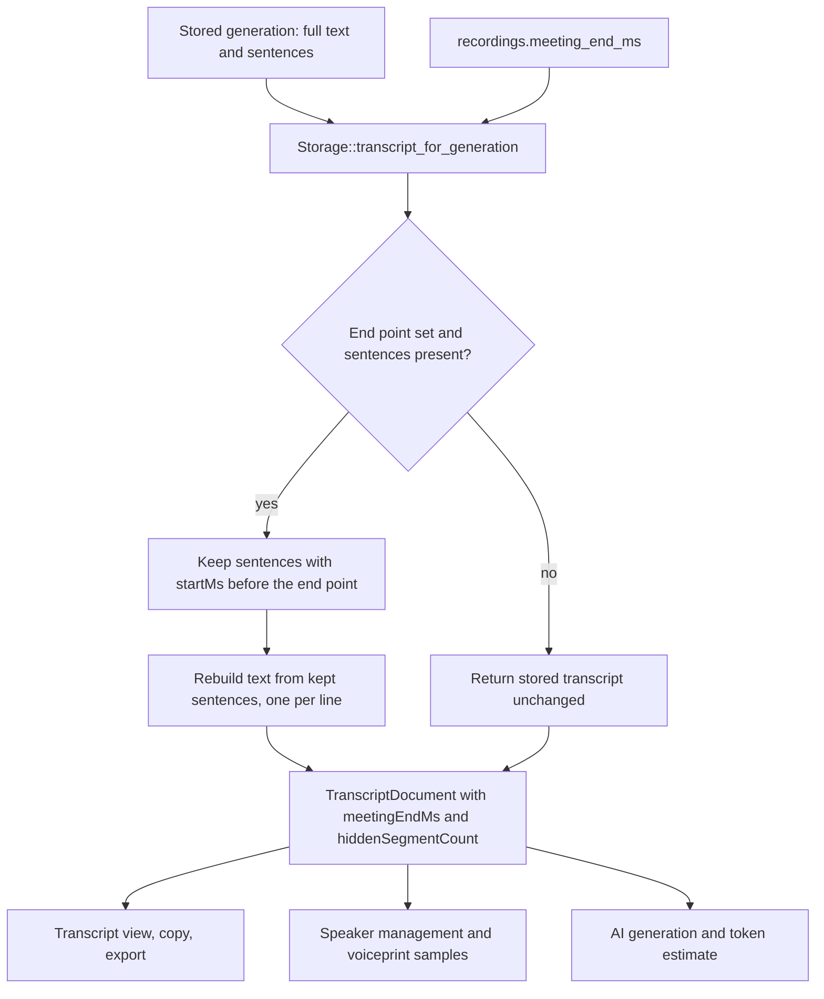

# Meeting End Point

- Status: Accepted
- Last updated: 2026-11-28
- Owners: Nota desktop maintainers
- Related code: `src-tauri/src/storage.rs`, `src-tauri/src/models.rs`,
  `src-tauri/src/controller.rs`, `src/components/RecordingsWorkspace.tsx`,
  `src/types.ts`
- Related decision:
  [`0019-recording-meeting-end-point.md`](decisions/0019-recording-meeting-end-point.md)

## Problem

A recording sometimes continues after the meeting ends because the user forgot
to stop it. The tail can contain unrelated conversation or noise. Its
transcript then appears in the transcript view, copy and export, speaker
management, and every AI document generated afterwards.

For example, one 2 h 34 min recording ended its meeting at 50:15. The
transcript held 115 further sentences, about 1,700 characters, mostly from
speakers who never spoke in the meeting.

## Goal and Non-Goals

The user marks where the meeting ended. Nota then treats transcript sentences
after that point as outside the meeting everywhere transcripts are read, and
the user can undo this at any time.

Non-goals for this change:

- editing, trimming, or deleting the recording audio;
- editing individual sentences;
- marking where a meeting started, or excluding ranges in the middle;
- transcribing only the audio before the end point (possible later with the
  lossless segment writer).

## Data Model

`recordings.meeting_end_ms INTEGER NULL` stores the end point in milliseconds
on the recording timeline. `NULL` means the whole recording belongs to the
meeting. The column is added by an idempotent startup migration and is
deleted with its recording.

The end point belongs to the recording, not to a transcription generation, so
it also applies to later retranscriptions and to switching between completed
generations.

A valid value is greater than 0 and less than `recordings.duration_ms`.

## Read Path

All transcript readers already go through `Storage::transcript` and
`Storage::transcript_for_generation`. The filter is applied there, so the
transcript view, copy, export, speaker management and voiceprint sample
selection, AI generation, and AI token estimates all see the same trimmed
transcript.

Rules:

- A sentence is kept when `startMs < meeting_end_ms`. A sentence that starts
  before the end point and ends after it is kept whole.
- When an end point is set and the generation has sentences, `text` is rebuilt
  from the kept sentences, one sentence per line, so copy without speaker
  labels never includes hidden text.
- A generation without sentence timestamps, such as some legacy-chunk results,
  is returned unchanged. `hiddenSegmentCount` is 0, and the UI explains that
  the end point cannot apply to that generation.
- Stored text, sentences, speaker names, and speaker assignments are never
  rewritten. Clearing the end point restores the full transcript exactly.
- Speaker-name and assignment writes keep validating raw labels against the
  full stored sentences. A label that appears only after the end point keeps
  any stored name but is not shown.

## IPC

`TranscriptDocument` gains two fields, synchronized between Rust and
TypeScript:

| Field | Type | Meaning |
|---|---|---|
| `meetingEndMs` | `number \| null` | The recording's end point |
| `hiddenSegmentCount` | `number` | Sentences excluded by the end point |

A new command `set_recording_meeting_end(recordingId, endMs | null)` validates
the value, stores it, and returns the trimmed `TranscriptDocument` for the
current generation. Setting the same value twice is a no-op, and `null` clears
it. `RecordingItem` does not carry the end point; the transcript view reads it
from the loaded `TranscriptDocument`.

## Interaction

- Hovering or keyboard-focusing a sentence reveals an icon-only row action
  (Lucide `FlagTriangleRight`) whose accessible name names the end time, for
  example "在 00:50:15 结束会议", with an `AppTooltip`. It sets the end point to
  that sentence's `endMs`, so the chosen sentence stays visible. The action is
  not offered on the last visible sentence; its slot stays reserved.
- After the last kept sentence, the transcript shows one quiet status row:
  "会议在 00:50:18 结束，之后 115 句已隐藏", with a "恢复全部" button that clears
  the end point. For a generation without sentences, the row explains that the
  end point cannot apply.
- Setting or clearing shows the existing transient toast with an undo action
  that restores the previous value. No confirmation dialog is needed because
  the change is reversible.
- Hidden sentences cannot be selected, so the end point can only move earlier.
  To move it later, the user restores the full transcript first.
- The player uses native audio controls, so it shows no end marker. Playback
  past the end point stays possible; the end point affects only transcripts.

## AI Documents

Existing AI document versions are unchanged. New documents and new versions
use the trimmed transcript. Each version already snapshots its exact request
body, which records which transcript the model received.

## Diagnostics

Logs may record that an end point was set or cleared for a recording id, and
the hidden sentence count. They never record transcript text.

## Acceptance

Automated tests:

- validation rejects 0, values at or beyond the duration, and unknown
  recordings; setting the same value twice succeeds;
- filtering keeps a sentence that straddles the end point, hides later ones,
  rebuilds text, and reports the hidden count, for both the current and an
  explicit generation;
- clearing restores the stored sentences and original text;
- the end point survives reopening the database;
- the row action is offered on every sentence except the last and reports the
  sentence end time;
- the end row reports the hidden count, restores the full transcript, and
  explains generations without sentences.

AI preparation, copy, export, and speaker management are covered by their
existing reads through `Storage::transcript`.

Manual acceptance uses a recording whose meeting ends early and confirms the
transcript view, copy, speaker list, a new AI document, and restore.
